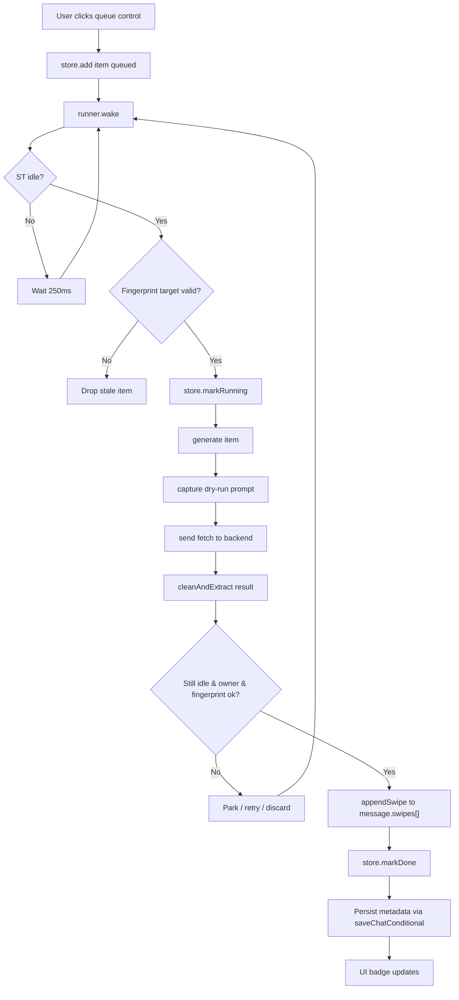

# Architecture & Summary — Queued Swipes for SillyTavern

A primer for developers new to this extension. The goal: answer "how does a queued swipe get built, sent, and appended?" without forcing you to read every module in dependency order.

---

## 1. What this does (in one paragraph)

Let the user queue several alternative replies for the latest AI message while keeping reading undisturbed. Each queued request runs **one at a time** through a dry-run prompt capture + own transport pipeline; on completion the result is appended as a normal swipe page (`k/total` grows) without changing which swipe is visible. The queue survives refreshes by storing in chat metadata. No parallel `Generate('swipe')` calls — that would corrupt ST's single-flight generation state.

---

## 2. How a queued swipe flows through the system

```
User clicks queue control
  → enqueue() adds item(s) to store (fingerprint of target message)
  → runner wakes
    → capture(): dry-run Generate('swipe') → captures prompt payload
    → send(): own fetch to /api/backends/* with captured prompt
    → cleanAndExtract(): stop-string trim, regex, reasoning parse (mirrors native onSuccess)
  → append(): push text into message.swipes[] + parallel swipe_info[], then saveChatConditional()
  → runner marks done → store updates metadata → UI badge updates
```

One pass through the loop per item. Nothing else fires `Generate('swipe')` — only the dry run.

---

## 3. Key design decisions (the "why")

| Decision | Why |
|---|---|
| **Serial queue, own transport** | Fire-and-forget `Generate('swipe')` breaks ST's global abort/streaming controller (`is_send_press`, single `AbortController`). Capture the prompt once, send over our own fetch, let ST's pipeline handle only the visible swipe. Total latency = N × item latency, but reading stays smooth. |
| **Dry-run capture** | `bridge.Generate('swipe', {}, true)` arms listeners that grab the exact prompt data the native swipe would build. This gives us an equivalent payload without holding ST's generation pipeline open. |
| **Append on completion** | Never pre-reserve swipe slots (empty slots show in pager, count is wrong). Hold results until they finish, then append to `swipes[]` so the pager just grows naturally. |
| **Fingerprint identity** | Each queued item stores a cheap djb2 hash of the target message + chat metadata integrity. Re-checked before every capture and before append (GUARD-04). A stale target is discarded silently. |
| **Persistence via chat metadata** | The queue is stored in `chatMetadata[moduleName]`, written through ST's own save functions only. A different tab may hold the "owner" claim and mirror the queue read-only. |
| **Ownership via localStorage** | One tab per chat owns the queue. A second tab takes over, shows read-only, and the owner loses the claim (up to ~48s under browser throttling if stolen mid-flight, item discarded). |

---

## 4. Module map

```
index.js              → Wiring: builds every subsystem, registers UI/slash/menu. Entry point.
src/st-bridge.js       → Thin wrapper exposing ST's context APIs (getContext, eventSource, etc.).
src/store.js           → In-memory queue store: add/drop/peek/markDone/persist. One instance per chat.
src/runner.js          → Single-flight scheduler: processes items serially, gates on idle/generation state.
src/adapter.js         → Generation adapter: capture() + send() + cleanAndExtract(). Owns the AbortController.
src/fingerprint.js     → Target-identity check: buildFingerprint, fingerprintStatus (chat vs target vs ok).
src/lifecycle.js       → Event watcher: when messages are edited/deleted/sent or chat changes, clears/pauses queue.
src/guard.js           → Guard policies: pause reasons, breaker trip, inspector gate.
src/ownership.js       → Tab ownership via localStorage key with TTL claim window.
src/mirror.js          → Cross-tab sync: mirrors owner's queue into read-only tabs.
src/persistence.js     → Snapshot serialization for cross-tab handoff and reload.
src/appender.js        → AppendSwipe(): writes result into message.swipes[] + swipe_info[], triggers save.
src/gapWarning.js      → First-queue gap toast: lists active interceptors not applied to queued swipes.
src/commands.js        → Slash commands: /queueswipe, /queuecancel, /queuestatus.
src/ui.js              → Queue control (clock icon), badge dropdown, cancel/resume controls.
src/wandMenu.js        → Extensions menu entries: "Queue swipe", "Cancel all queued".
src/progressBar.js     → Stop/Resume progress bar widget.
src/settings.js        → Settings drawer: max queue, auto-jump, notification style, circuit breaker threshold.
```

---

## 5. The critical constraint: single-flight

ST's generation pipeline relies on module-level globals: `is_send_press`, a single `abortController`, "generation in progress" UI, and `mesSend`-style locking. **You cannot fire multiple `Generate('swipe')` calls concurrently.** The plugin exists specifically because the native swipe can only produce one alternative at a time.

The plugin sidesteps this by never holding the pipeline open for more than one request at a time:

1. **Capture** — `Generate('swipe', {}, true)` is a dry run that returns the prompt data without entering the full streaming pipeline.
2. **Send** — Our own `fetch()` to the backend with the captured prompt, complete with its own `AbortController`.
3. **Append** — When the fetch resolves, we push the text directly into `message.swipes[]`. We never switch `mes` to the new content during generation.

The Runner (`src/runner.js`) enforces serial execution with an idle gate: it won't start the next item until ST has no active generation and no other queued swipe is "running".

---

## 6. Where results land

On completion, `appendSwipe()` (in `src/appender.js`) does:

```javascript
message.swipes[message.swipe_id] = text;           // into the current swipe slot
message.swipe_info.push({ ... }, ...)              // parallel array with timestamps
saveChatConditional();                             // saves through ST's own path
```

Key rules:
- Appends to the **current** `swipe_id` slot (doesn't reserve new slots).
- Increments the pager counter automatically — no DOM manipulation needed.
- Does **not** change `swipe_id` unless the user opted into "Jump to newest swipe on completion" setting.

---

## 7. Queue lifecycle at a glance



Pause reasons (priority order): `takeover` > `restored` > `inspector` > `connection` > `failures` > `native`. Pause on each as conditions arise; resume clears them.

---

## 8. Integration with ST

### Trigger points (verified against ST source)
- `GENERATION_STARTED` event type — armed for dry-run swipe detection.
- `GENERATE_AFTER_DATA` event type — capture point: the generated prompt payload arrives here during dry-run.
- `swipe_right` guard: `isSwipingAllowed` at `script.js:9162-9169`.
- `GENERATION_STOPPED`, `MESSAGE_SWIPED` — listened for lifecycle bookkeeping.
- `CHAT_CHANGED` — switches chats, pauses queue, offers resume popup.

### What interceptors don't see
Queued swipes bypass extension-level prompt interceptors (Vector Storage, Parameter Randomizer, WebSearch, etc.) because they go through our own transport, not ST's `Generate()` path. Prompt-caching for identical prompts **helps**: queued prompts are cached since they're sequential, but parallel ones wouldn't be.

### Settings storage
All settings live in `extensionSettings[MODULE_NAME].maxQueueSize`, etc., saved via `saveSettingsDebounced()`. The hard cap is 20 regardless of config.

---

## 9. Edge cases worth knowing

| Situation | Behavior |
|---|---|
| User edits the target message | Queue cleared (items marked `failed`, reason `edited`); nothing appended. |
| User deletes the target message | Same: cleared silently, no failure toast. |
| User sends a new message | Cleared, no toast. |
| Item fails (API error, empty) | Item dropped from queue; other items continue. After N consecutive failures, queue auto-pauses. |
| Another tab takes ownership | This tab becomes read-only; owner's items remain queued, paused. |
| Message changes while generating | Fingerprint mismatch at GUARD-04 → item discarded silently. |
| Manual "stop" during generation | Aborts adapter's own controller; item dropped with reason `cancelled`; others continue. |

---

## 10. Quick start for a new developer

Read in this order:

1. **`index.js`** — how everything is wired together. Read once, then jump to the module you need.
2. **`src/adapter.js`** — what a queued swipe actually *does*: capture → send → clean. This is the heart of the feature.
3. **`src/runner.js`** — the scheduler that drives the loop. Understand `processNext()` and the idle/pause gates.
4. **`src/store.js`** — the data model. `add()`, `markDone()`, `writeMetadata()` tell you where state lives.
5. **`src/lifecycle.js`** — when events invalidate the queue. READ this before touching any event handler.
6. **`src/fingerprint.js`** — why identity matters (GUARD-04 re-check).
7. **`AGENTS.md`** — project constraints, integration points, gotchas. Always read before modifying.
